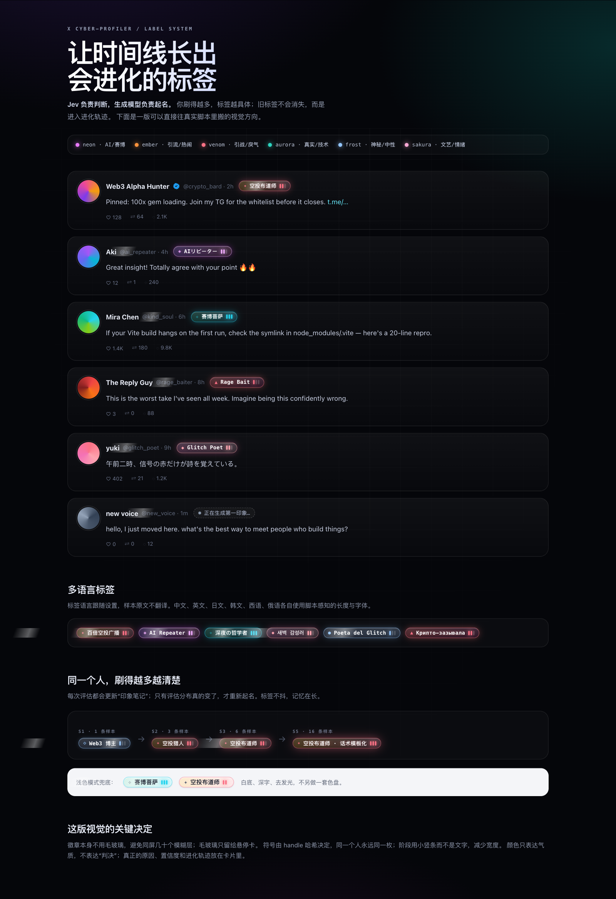
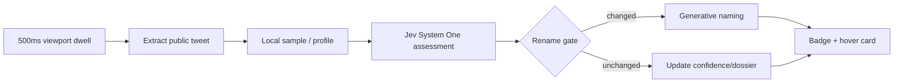
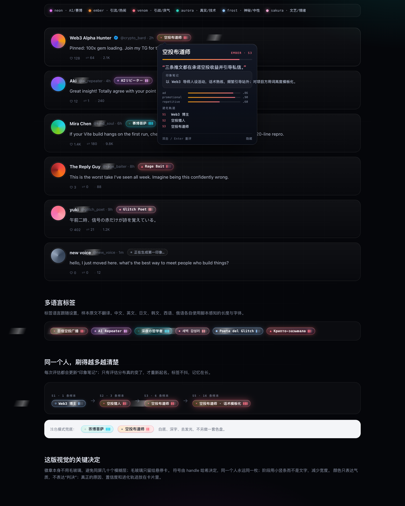
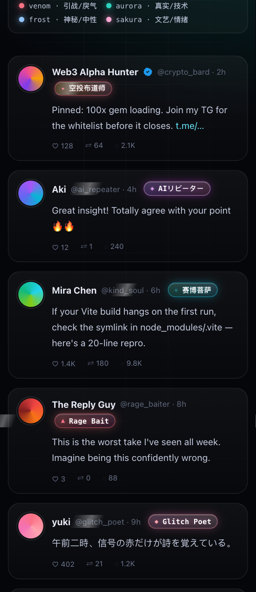

# X Cyber-Profiler

[中文](README.md) | **English**

> An evolving cyber filter for your X timeline.  
> Jev judges; a generative model names. The more you scroll, the more specific the labels become.

[中文](README.md) | **English**



## What it is

X Cyber-Profiler is a **local-first** profile-labeling userscript for Tampermonkey:

- Reads only public tweets already rendered in your viewport.
- Uses **Jev / TypeSafe System One** for structured assessment: archetype, traits, valence/energy, evidence.
- Uses **any generative model** to turn the assessment into a short, memorable label.
- Labels evolve as samples accumulate; old labels stay in a visible history.
- **No blocking, no muting, no reporting, no X write requests.**
- Defaults to local **Magpie**: **no API keys** for either Jev or naming.

## Features

| Feature | Description |
| --- | --- |
| Dynamic labels | Open vocabulary, not a fixed four-class taxonomy |
| Continuous evolution | S1–S9+ stages, cooldowns, stable state |
| Dossier | A cumulative impression note carried across sessions |
| Rename gate | Renames only when the assessment distribution actually changes |
| Zero-key local models | Magpie serves both `jev-latest` and any chat model |
| Multilingual | Labels follow `labelLang`: zh/en/ja/ko/es/fr/de/ru |
| Fully automatic | Every account with ≥1 valid sample enters the queue |
| Visual | Six vibes, sigil, stage pips, hover evidence card, light-mode fallback |
| Local-first | Profiles live in GM storage; only samples go to your configured endpoint |
| Auto-update | `@updateURL` points to GitHub raw |

## How it works



- **Jev**: `POST /v1/systemone`, 22 questions (5-class choice + 8 traits + valence/energy + 11 evidence nouls).
- **Namer**: OpenAI-compatible chat; turns assessment, old label, dossier and recent samples into `label / vibe / reason / dossier`.
- **Gate**: renames only when archetype, top trait, L1 distance, confidence, language or tone changes.

## Quick start

### 1. Install Tampermonkey

Install [Tampermonkey](https://www.tampermonkey.net/) in Chrome, Edge or Firefox.

### 2. Install the userscript

Click:

```text
https://raw.githubusercontent.com/JohnWangggg/x-cyber-profiler/main/dist/x-cyber-profiler.user.js
```

Or paste `dist/x-cyber-profiler.user.js` into a new Tampermonkey script.

### 3. Start local Magpie

The default configuration assumes:

```text
http://127.0.0.1:3425
```

Check:

```bash
curl http://127.0.0.1:3425/
```

Magpie exposes:

```text
POST http://127.0.0.1:3425/v1/systemone       → jev-latest
POST http://127.0.0.1:3425/v1/chat/completions → any chat model
```

### 4. Configure

Open X → Tampermonkey menu → `XCP 设置` → **全部使用本地 Magpie** → Save.

Defaults:

| Field | Value |
| --- | --- |
| Evaluator | Jev |
| Jev URL | `http://127.0.0.1:3425/v1` |
| Jev model | `jev-latest` |
| Jev key | empty |
| Namer provider | `openai` |
| Namer URL | `http://127.0.0.1:3425/v1/chat/completions` |
| Namer model | `auto/glm-5.3-flash` |
| Namer key | empty |

Click `测试 Jev` and `测试起名`; both should show a success toast.

### 5. Use

Scroll and dwell for ~500ms:

- Unknown account: ghost badge, then a provisional label, then the final label.
- Cached account: instant label, zero network requests.
- Hover/focus: evidence card with reason, dossier, confidence and history.
- Double-click or Enter: force re-evaluation.
- `XCP 今日用量`: usage, budget, mode and version.

## Zero-key local Magpie

| Purpose | Endpoint | Model |
| --- | --- | --- |
| Assessment | `http://127.0.0.1:3425/v1` | `jev-latest` |
| Naming | `http://127.0.0.1:3425/v1/chat/completions` | `auto/glm-5.3-flash` |

Local `http://127.0.0.1` endpoints are allowed without keys.  
You can also switch to direct TypeSafe, OpenAI/DeepSeek/Kimi, Gemini, Anthropic, Ollama or another OpenAI-compatible gateway.

## Model selection

Evaluator and namer are configured independently:

- Evaluator: `jev-latest` / `jev-preview` (System One).
- Namer: any chat model.

List local models:

```bash
curl -s http://127.0.0.1:3425/v1/models | jq -r '.data[].id'
```

Common namers:

```text
auto/glm-5.3-flash
auto/kimi-k3
auto/deepseek-v4.1-flash
auto/qwen3.8-max
auto/gpt-6-luna
auto/gemini-3.8-flash
```

The settings field is editable and has suggestions; any model ID works.

## Multilingual labels

The `labelLang` setting controls label, reason and dossier language. Samples are never translated.


Real examples:

| Language | Label |
| --- | --- |
| Chinese | `百倍空投广播` |
| English | `100x Gem Shill` |
| Japanese | `TG案件ブローカー` |
| Korean | `100배 텔레그램` |
| Spanish | `Cazador de 100x` |
| French | `Colporteur de 100x` |
| German | `Krypto-Linkwerfer` |
| Russian | `Крипто-зазывала` |

- `auto` follows the browser language.
- Script-aware length validation: 3–10 CJK characters, 2–12 Hangul, 1–3 Latin words.
- Font stack includes Noto Sans SC/JP/KR; RTL-safe.

## Evolution

| Stage | Samples | Cooldown |
| --- | --- | --- |
| S1 | 1 | immediate |
| S2 | 3 | 10 min |
| S3 | 6 | 30 min |
| S4 | 10 | 1 hour |
| S5 | 16 | 3 hours |
| S6 | 24 | 6 hours |
| S7 | 36 | 12 hours |
| S8 | 50 | 24 hours |
| S9+ | +20 or 7 days | 24 hours |

- No permanent lock.
- Old labels go to `history`; the hover card shows the latest three.
- Manual double-click / Enter bypasses cooldown and the rename gate.

## Visual



- Six vibes: `neon / ember / venom / aurora / frost / sakura`
- Handle-derived sigil
- Three stage pips; `9+` at high stages
- No `backdrop-filter` on badges; one blur layer on the hover card
- Light mode is a readability fallback only



## Auto-update

The header contains:

```text
// @version      1.0.5
// @updateURL    https://raw.githubusercontent.com/JohnWangggg/x-cyber-profiler/main/dist/x-cyber-profiler.user.js
// @downloadURL  https://raw.githubusercontent.com/JohnWangggg/x-cyber-profiler/main/dist/x-cyber-profiler.user.js
```

Release:

```bash
npm run release -- patch
git add -A
git commit -m "release vX.Y.Z"
git push
```

Tampermonkey checks the raw file periodically; manual “Check for updates” also works.

## Privacy

- Read-only DOM; no X API / GraphQL / write requests.
- Profiles stay in local GM storage.
- Only tweet samples go to your configured evaluator/namer endpoint.
- Keys never appear in exports, logs or URLs; local Magpie needs no key.
- Labels are model inferences, not facts. Re-evaluate, hide or clear them at any time.

## Development

```bash
npm test              # 179 tests
npm run build         # assemble the userscript
npm run check         # dist freshness
npm run smoke         # assembled end-to-end smoke
npm run check:exports # module export contract
```

Real local probes:

```bash
npm run probe:jev     # TypeSafe System One
npm run probe:app     # Jev + namer pipeline
```

`.env.local` is only for CLI probes and is gitignored; the userscript uses the settings UI.

## More docs

- [Configuration & models](docs/CONFIGURATION.en.md)
- [Upgrade & data retention](docs/UPGRADE.en.md)
- [Performance & storage](docs/PERFORMANCE.en.md)
- [Changelog](CHANGELOG.en.md)

## Project layout

```text
src/                 userscript modules
test/                unit + integration tests
tools/               assemble / release / probes / benchmarks
docs/screenshots/    README images
dist/                installable userscript
```

## Troubleshooting

| Symptom | Check |
| --- | --- |
| No badge | Tampermonkey enabled? x.com? Reload |
| Mode says not configured | Click “全部使用本地 Magpie” and save |
| `测试 Jev` fails | Is Magpie running? URL `http://127.0.0.1:3425/v1` |
| Namer model rejected | Version 1.0.2+ allows `/`; check version |
| `HTTP 451` | Direct TypeSafe is region-blocked; use local Magpie |
| `EMPTY` | Reasoning model consumed tokens; switch model or keep 1500 |
| `BAD_LABEL` | Model output invalid; switch model or tone |
| Requests increase but no label | Console filter `[xcp]`; look for `BAD_LABEL / BAD_JSON / EMPTY` |

## Changelog

[CHANGELOG.md](CHANGELOG.md) · [English](CHANGELOG.en.md)

## License

[MIT](LICENSE) © 2026 JohnWangggg

> Personal timeline aid and entertainment only. Labels may be wrong; do not treat them as facts or use them for harassment, discrimination or automated attacks.
