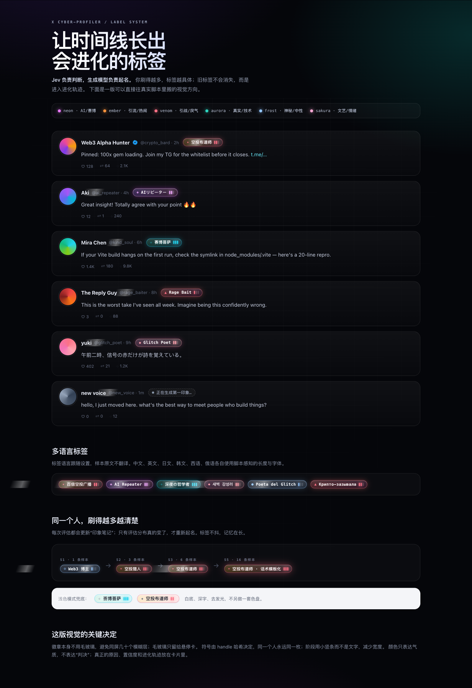
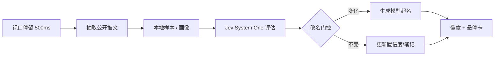
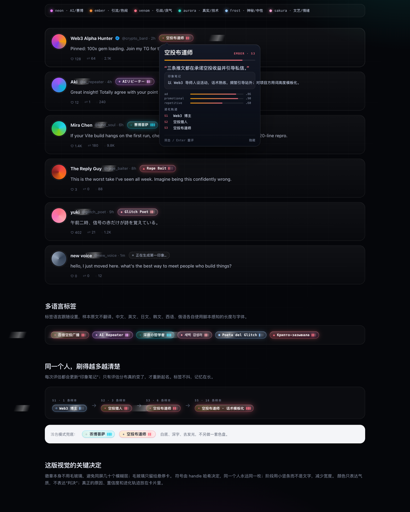
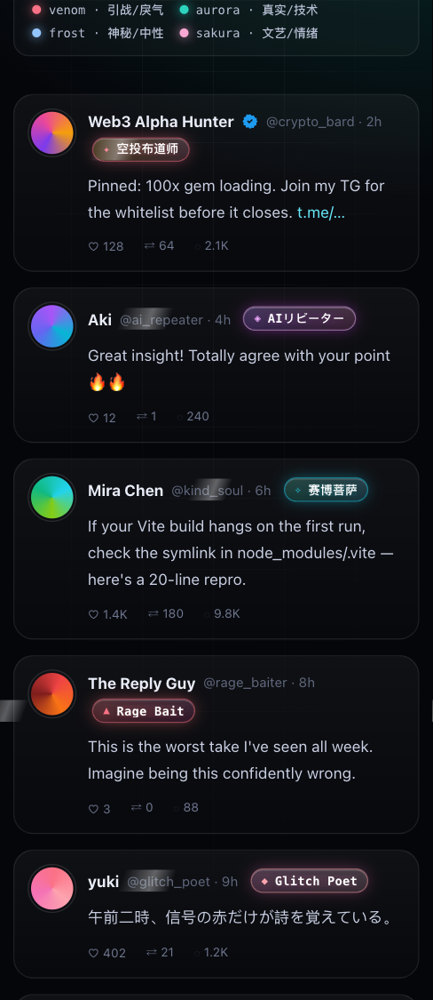

# X Cyber-Profiler

[中文](README.md) | [English](README.en.md)

> 给 X 时间线加一层会进化的赛博滤镜。  
> Jev 负责判断，生成模型负责起名；你刷得越多，标签越具体。



## 这是什么

X Cyber-Profiler 是一个运行在 Tampermonkey 里的**本地优先**账号画像工具：

- 只读你眼前已经渲染的公开推文。
- 用 **Jev / TypeSafe System One** 做结构化评估：类别、traits、valence/energy、evidence。
- 用**任意生成模型**把评估结果写成好玩、具体、可截图分享的标签。
- 标签会随样本累积继续进化；旧标签进入进化轨迹，不会消失。
- **不拉黑、不折叠、不举报、不调用 X 写接口。**
- 默认走本地 **Magpie**，Jev 和起名模型都**不需要 Key**。

## 核心特性

| 能力 | 说明 |
| --- | --- |
| 动态标签 | 开放词库，不是固定四类；模型每次可以造新词 |
| 持续进化 | S1–S9+ 阶段 + 冷却 + 稳定态；刷得越多越具体 |
| 印象笔记 | 每次进化累积 `dossier`，跨会话保留 |
| 改名门控 | 评估分布没变就不重新起名，标签不抖、Token 不浪费 |
| 零 Key 本地模型 | Magpie 同时提供 `jev-latest` 与任意 chat 模型 |
| 多语言 | 标签语言跟随设置：中/英/日/韩/西/法/德/俄 |
| 全自动 | 每个有 1 条有效样本的账号自动进入队列 |
| 好看 | 6 色气质盘、符号、阶段刻度、悬停证据卡、浅色兜底 |
| 本地优先 | 档案在 GM 存储；只把样本发给你配置的接口 |
| 自动更新 | `@updateURL` 指向 GitHub raw，发版后自动检查 |

## 工作原理



- **Jev**：`POST /v1/systemone`，一次问 22 个问题（5 类 choice + 8 traits score + valence/energy + 11 evidence noul）。
- **生成模型**：OpenAI-compatible chat，把评估、旧标签、印象笔记和最近样本写成 `label / vibe / reason / dossier`。
- **门控**：`archetype`、top trait、L1 距离、置信度、语言/语气任一变化才重新起名。

## 快速开始

### 1. 安装 Tampermonkey

Chrome / Edge / Firefox 安装 [Tampermonkey](https://www.tampermonkey.net/)。

### 2. 安装脚本

点击：

```text
https://raw.githubusercontent.com/JohnWangggg/x-cyber-profiler/main/dist/x-cyber-profiler.user.js
```

或在 Tampermonkey 里新建脚本，粘贴 `dist/x-cyber-profiler.user.js`。

> 安装后 Tampermonkey 会按 `@updateURL` 自动检查更新；发版只需 push 新的 `dist`。

### 3. 启动本地 Magpie

默认配置假设本机 Magpie 在：

```text
http://127.0.0.1:3425
```

确认：

```bash
curl http://127.0.0.1:3425/
```

Magpie 同时提供：

```text
POST http://127.0.0.1:3425/v1/systemone       → jev-latest
POST http://127.0.0.1:3425/v1/chat/completions → 任意 chat 模型
```

### 4. 配置

打开 X → 油猴菜单 → `XCP 设置` → 点 **全部使用本地 Magpie** → 保存。

默认值：

| 字段 | 值 |
| --- | --- |
| 评估模式 | Jev 评估 + 生成起名 |
| Jev URL | `http://127.0.0.1:3425/v1` |
| Jev 模型 | `jev-latest` |
| Jev Key | 留空 |
| 起名 Provider | `openai` |
| 起名 URL | `http://127.0.0.1:3425/v1/chat/completions` |
| 起名模型 | `auto/glm-5.3-flash` |
| 起名 Key | 留空 |

点 `测试 Jev` 和 `测试起名`，都应显示 `连接正常`。

### 5. 使用

滚动时间线，停留约 500ms：

- 无标签：先出现幽灵徽章 `正在生成第一印象…`
- 有评估无标签：保留幽灵/忙碌态，起名成功后替换
- 已打标：霓虹胶囊
- 悬停/聚焦：证据卡（理由、印象笔记、置信度、进化轨迹）
- 双击或 Enter：强制重评
- `XCP 今日用量`：查看请求数、预算、模式、版本号

## 零 Key 本地 Magpie

| 用途 | Endpoint | 模型 |
| --- | --- | --- |
| 评估 | `http://127.0.0.1:3425/v1` | `jev-latest` |
| 起名 | `http://127.0.0.1:3425/v1/chat/completions` | `auto/glm-5.3-flash` |

本地 `http://127.0.0.1` 端点允许无 Key；`effectiveMode` 会把本地端点视为可用 Namer/Evaluator。

也可以切换到：

- 直连 TypeSafe：`https://api.typesafe.ai/v1` + Key
- OpenAI / DeepSeek / Kimi / Gemini / Anthropic
- Ollama（`http://localhost:11434/v1/chat/completions`）
- 其他 OpenAI-compatible 网关

## 模型选择

评估模型和起名模型**分开配置、都可自选**：

- 评估：`jev-latest`、`jev-preview`；必须走 System One。
- 起名：任意 chat 模型。

查看本机 Magpie 可用模型：

```bash
curl -s http://127.0.0.1:3425/v1/models | jq -r '.data[].id'
```

常用起名模型：

```text
auto/glm-5.3-flash
auto/kimi-k3
auto/deepseek-v4.1-flash
auto/qwen3.8-max
auto/gpt-6-luna
auto/gemini-3.8-flash
```

设置里的模型输入框带建议列表，也可以直接填任意模型 ID。

## 多语言标签

标签语言由设置里的 `标签语言` 决定；样本原文不翻译。


真实运行示例：

| 语言 | 标签 |
| --- | --- |
| 中文 | `百倍空投广播` |
| English | `100x Gem Shill` |
| 日本語 | `TG案件ブローカー` |
| 한국어 | `100배 텔레그램` |
| Español | `Cazador de 100x` |
| Français | `Colporteur de 100x` |
| Deutsch | `Krypto-Linkwerfer` |
| Русский | `Крипто-зазывала` |

- `auto` 跟随浏览器语言。
- 校验按脚本感知长度：中文 3–10 字、日文 3–12 字符、韩文 2–12 字符、拉丁 1–3 词。
- 字体栈包含 `Noto Sans SC/JP/KR`，RTL 安全。

## 标签系统

| 阶段 | 样本数 | 冷却 |
| --- | --- | --- |
| S1 | 1 | 立即 |
| S2 | 3 | 10 分钟 |
| S3 | 6 | 30 分钟 |
| S4 | 10 | 1 小时 |
| S5 | 16 | 3 小时 |
| S6 | 24 | 6 小时 |
| S7 | 36 | 12 小时 |
| S8 | 50 | 24 小时 |
| S9+ | 每 +20 或 7 天 | 24 小时 |

- 没有永久锁；稳定态只会降低频率。
- 旧标签进入 `history`，悬停卡显示最近 3 条。
- 手动双击/Enter 跳过冷却与改名门控。

## 视觉



- 6 色气质盘：`neon / ember / venom / aurora / frost / sakura`
- 符号由 handle 哈希决定，同一个人永远同一枚
- 阶段刻度 3 格，`stage ≥ 9` 显示 `9+`
- 徽章本身不用 `backdrop-filter`；只有悬停卡用一次 `blur(16px)`
- 浅色模式只做可读性兜底



## 自动更新（发布后启用）

脚本头部已配置：

```text
// @version      1.0.5
// @updateURL    https://raw.githubusercontent.com/JohnWangggg/x-cyber-profiler/main/dist/x-cyber-profiler.user.js
// @downloadURL  https://raw.githubusercontent.com/JohnWangggg/x-cyber-profiler/main/dist/x-cyber-profiler.user.js
```

发版流程：

```bash
npm run release -- patch
git add -A
git commit -m "release vX.Y.Z"
git push
```

`release` 会同步 `package.json`、`src/constants.js`、`src/userscript.header`，然后 build / check / test / smoke。

Tampermonkey 会周期性检查 raw 文件；也可以在管理面板手动“检查更新”。

## 隐私与边界

- 只读 DOM；不调用 X API / GraphQL / 写接口。
- 档案在本地 GM 存储。
- 只把推文样本发给你配置的评估/起名接口。
- Key 不进导出、不进日志、不进 URL；本地 Magpie 可完全无 Key。
- 标签是**模型推断**，不是事实；可重评、可隐藏、可清空。
- 不做内容审核、不自动拉黑、不批量操作。

## 开发

```bash
npm test              # 178 个用例
npm run build         # 组装单文件 userscript
npm run check         # dist 与源码一致
npm run smoke         # 组装产物端到端冒烟
npm run check:exports # 模块导出契约
```

本地真实链路探测：

```bash
npm run probe:jev     # 真实 TypeSafe System One
npm run probe:app     # Jev + 起名完整流水线
```

`.env.local` 只用于命令行探测，已被 `.gitignore` 忽略；userscript 的设置以菜单为准。

## 更多文档

- [配置与模型指南](docs/CONFIGURATION.md)
- [性能与存储基准](docs/PERFORMANCE.md)
- [升级与数据保留](docs/UPGRADE.md)
- [Changelog](CHANGELOG.md)
- [更新日志](CHANGELOG.md)

## 项目结构

```text
src/
  constants.js       常量与默认配置
  selectors.js       DOM 选择器
  storage.js         GM 存储 / 索引 / 配额 / 多标签页
  sample.js          文本分类 / 入库 / 阶段
  assess.js          Jev System One 请求与归一化
  name.js            起名 Prompt / 标签校验 / 兜底
  queue.js           令牌桶队列
  providers.js       OpenAI / Gemini / Anthropic / Jev
  llm.js             传输 / 重试 / 错误
  extract.js         推文字段 / 文本 walker
  observe.js         视口 / 停留 / 身份守卫
  render.js          徽章 / 悬停卡 / 修复
  menu.js            设置 / 导入导出 / 测试连接
  boot.js            组合根
test/                单元与集成测试
tools/               组装 / 发布 / 探测 / 冒烟
docs/screenshots/    README 截图
dist/                可安装 userscript
```

## 排错

| 现象 | 检查 |
| --- | --- |
| 没有徽章 | Tampermonkey 是否启用；URL 是否 x.com；刷新页面 |
| 模式显示 `未配置` | `全部使用本地 Magpie` 后是否保存 |
| `测试 Jev` 失败 | Magpie 是否在跑；URL 是否为 `http://127.0.0.1:3425/v1` |
| `测试起名` 模型名错误 | 1.0.2+ 允许 `/`；确认版本不是旧版 |
| `HTTP 451` | 直连 TypeSafe 被区域限制；改用本地 Magpie |
| `EMPTY` | 起名模型 reasoning 占满 token；模型换小一点或保留 1500 |
| `BAD_LABEL` | 模型输出不合规；换模型或调语气 |
| 请求数增加但无标签 | Console 过滤 `[xcp]`，看 `BAD_LABEL / BAD_JSON / EMPTY` |

## License

[MIT](LICENSE) © 2026 JohnWangggg

> 本项目仅供个人时间线辅助与娱乐。标签可能不准确；请自行判断，不要把它当作事实或用于骚扰、歧视、自动化攻击。
